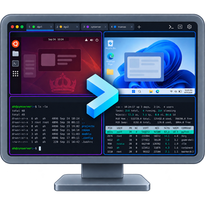
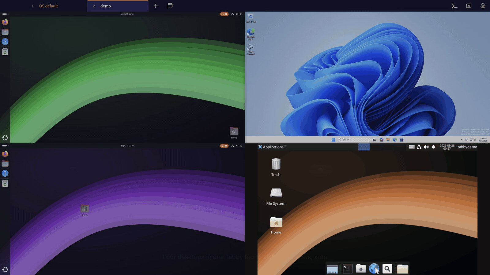
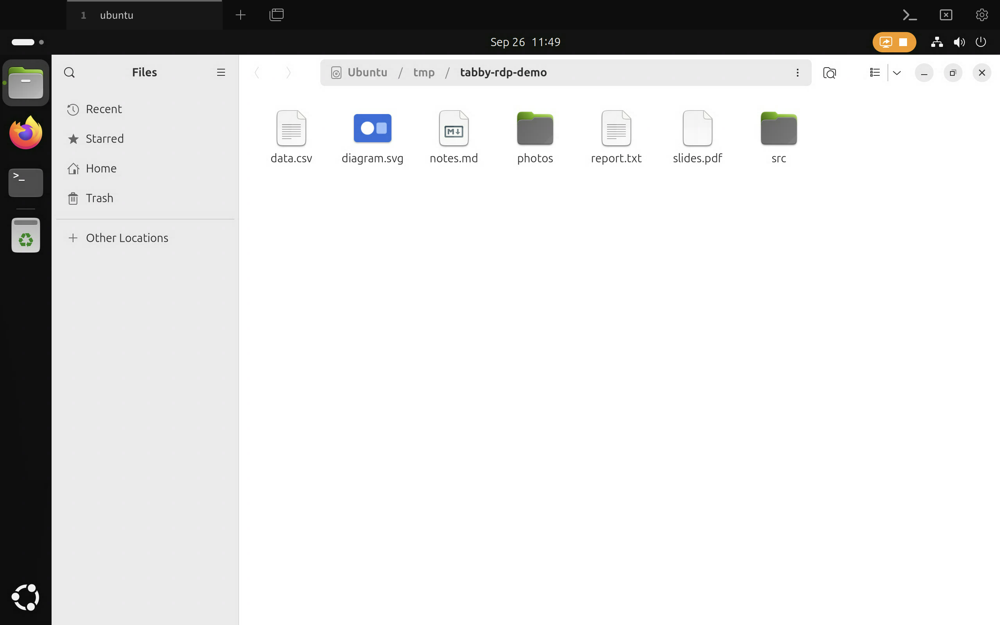
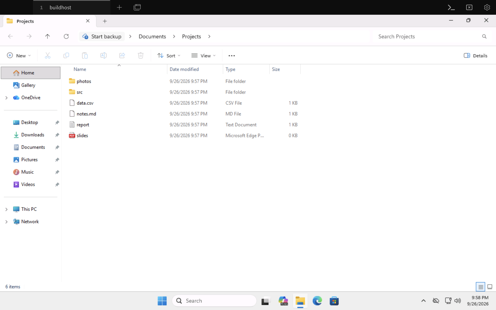

<div align="center">



# tabby-rdp

**Windows and Linux desktops inside Tabby.**<br>
Connect through SSH, directly over RDP, or through an RD Gateway.

[](https://www.npmjs.com/package/tabby-rdp)
[](LICENSE)
[](https://tabby.sh)



<sub>Sharper: <a href="https://github.com/meanaverage/tabby-rdp/releases/download/v0.3.0/tabby-rdp-demo.mp4">the same demo as an MP4</a> (downloads)</sub>

</div>


---

tabby-rdp adds remote desktops to the [Tabby](https://tabby.sh) terminal. Switch an SSH pane between its shell and
desktop, or open an RDP profile in a tab of its own. Split tabs to work with several machines side by side.

**Windows, Xfce, KDE Plasma, MATE, Cinnamon and GNOME** can be reached through their RDP servers. GNOME also supports
automatic headless setup over SSH. Server requirements and tested coverage are [below](#supported-desktops).

[Install](#install) · [Get started](#use) · [Connection options](#connection-options) · [User guides](#user-guides) ·
[Troubleshooting](TROUBLESHOOTING.md)

## Install

In Tabby, open **Settings › Plugins**, search for **tabby-rdp**, install, and restart Tabby.
Requires **Tabby 1.0.236 or newer** on macOS, Windows or Linux.

For a terminal installation, run `npm install tabby-rdp` in Tabby's plugin folder:

| This computer | Plugin folder |
|---|---|
| macOS | `~/Library/Application Support/tabby/plugins` |
| Linux | `~/.config/tabby/plugins` |
| Windows | `%APPDATA%\tabby\plugins` |

<a id="versions-and-recovery"></a>

Choose stable or preview updates in **Settings › Remote Desktop › Updates**. Installation is always your choice;
restart Tabby afterward. See [versions and recovery](docs/settings.md#versions-and-recovery).

## Use

1. Open an SSH tab to a machine with a supported desktop server.
2. Press **⌘⇧G** on macOS or **Ctrl+Shift+G** on Windows/Linux, or click **Desktop** in the SSH tab's toolbar.
3. Press the shortcut again to return to the console. The desktop keeps running until you disconnect or close it.

For GNOME, the first connection prepares a headless session without root or a monitor. With xrdp or Windows,
the plugin uses the existing RDP server and asks for your account. A host with both GNOME and xrdp offers the xrdp
desktop separately after its GNOME desktop has been opened.

<p align="center"></p>

<a id="requirements"></a>
<a id="tested-environments"></a>

## Supported desktops

| Remote OS / desktop | RDP server | Setup and coverage |
|---|---|---|
| Windows 10/11 Pro and Windows Server | Windows Remote Desktop | Enable Remote Desktop; connect directly or through SSH / RD Gateway. Windows 11 has visual QA coverage; the FreeRDP preview was also tested against Server 2025. |
| Linux: Xfce, KDE Plasma, MATE, Cinnamon and others | xrdp | Uses the desktop configured for xrdp sessions. Rocky Linux 9 with Xfce is tested; other desktop combinations need their own qualification. |
| Linux: GNOME | GNOME Remote Desktop 46+ | Automatic headless setup for the SSH user. Ubuntu, Debian and Fedora have visual QA coverage. |
| Linux: KDE Plasma through KRDP | KRDP | Experimental: the tested Fedora stack needs server patches; stock KRDP and live monitor resize remain unqualified. |

The client runs on **macOS, Windows and Linux**. These are separate from the OS of the remote desktop.
See [requirements, exact test environments and limitations](docs/compatibility.md) for server versions, optional
channels and pending coverage. The FreeRDP client preview has a narrower platform and feature set than IronRDP.

<a id="windows-and-other-desktops-behind-a-host"></a>
<a id="remote-desktop-profiles"></a>
<a id="through-an-rd-gateway"></a>
<a id="vms-on-a-host"></a>
<a id="hyper-v"></a>

## Connection options

| Connect to | Remote OS | Setup | What opens |
|---|---|---|---|
| The SSH host's own desktop | Linux or Windows | Open SSH, then **Desktop**. Windows hosts need OpenSSH Server and Remote Desktop. | Desktop in that SSH pane; switch back to its console |
| A desktop behind an SSH host | Windows or Linux | **Desktops › Add a desktop behind \<host\>…**; enter the address as the SSH host sees it | Desktop through the existing SSH connection |
| A machine on the LAN or VPN | Windows or Linux | **Settings › Profiles & connections › New profile › Remote desktop (RDP)** | A dedicated desktop tab |
| A machine reached through an RD Gateway | Windows or Linux | Set the profile's **RD Gateway** and the desktop address as the gateway sees it | RDP tunneled over HTTPS |
| A Hyper-V VM console | Any guest OS; Windows host | Select the VM in the Windows SSH host's **Desktops** menu | VM console; no guest RDP server required; IronRDP only |

Behind-host desktops can be edited or removed from the menu. RDP profiles also support SSH routing, quick connect
with `user@host:port`, and **Import an .rdp file…**. See the [connection guide](docs/connections.md) for setup, import
behavior, VM discovery and waking desktops. The [edit/removal table](docs/credentials-and-trust.md#what-changes-when-you-edit-a-desktop)
explains what happens to saved passwords and certificates.

<p align="center"></p>

<a id="clipboard"></a>
<a id="shared-folders"></a>
<a id="several-desktops-in-one-tab"></a>

## Features

These features describe the default **IronRDP** client. The FreeRDP preview's limits are [below](#rdp-client-preview).

| Feature | What you can do |
|---|---|
| Clipboard and files | Copy text, images, files and folders; choose both ways, remote-to-local only, or off. Drag files onto a desktop or use **Send files…**. |
| Shared folders | Expose local folders as read-only or writable drives on Windows and compatible xrdp servers. |
| Sound and microphone | Play remote sound locally; optionally send your microphone when a remote app records. Microphone sharing is off by default. |
| Display | Live resize, Retina sharpness, fit-to-pane or actual-size display, screenshots and optional connection statistics. |
| Keyboard | Mac shortcuts, **Send keys**, Unicode input and view-only mode. |
| Several desktops | Split tabs, paste or type into visible desktops together, and show each desktop's name. |
| Reconnect | Recover after sleep or a network interruption. |
| Sign-in | Save passwords in Tabby's Vault or the system keychain; reuse named accounts across desktops. |

Clipboard, shared folders and microphone settings determine what a remote desktop can access.
See [sharing and controls](docs/sharing.md) and [accounts and certificate trust](docs/credentials-and-trust.md).

<a id="desk-the-console-on-the-desktop"></a>

With **desk** enabled, typing `desk` in an SSH console moves the same shell, history and running jobs into a terminal
on the GNOME desktop. It is optional and off by default. [How desk works](docs/desk.md).

## RDP client preview

**Settings › Remote Desktop › Settings › RDP client** selects **IronRDP** or experimental **FreeRDP**. Profiles and
behind-host desktops can override the default. Changes apply on the next connection.

In an RDP profile tab's **…** menu, choose **RDP client** to switch that profile and optionally **Reconnect to apply**.

| Client | Availability | Capabilities |
|---|---|---|
| IronRDP (default) | macOS, Windows and Linux | The features above, subject to the server's capabilities |
| FreeRDP (experimental) | macOS ARM64; Windows and Linux ARM64/x64 native helpers | In-tab display, keyboard/mouse, scaling, resize, view only, screenshots and reconnect. Clipboard, files, audio, shared folders, Hyper-V and H.264 are pending. |

Windows Server performance has **not been benchmarked**. See [FreeRDP builds, licensing and capability notes](native/README.md).
To try the preview, open **Settings › Remote Desktop › Updates**, choose **Preview**, and install the offered version.

<a id="settings"></a>
<a id="saved-accounts"></a>
<a id="limitations"></a>

## User guides

| Guide | Find out about |
|---|---|
| [Connections and VMs](docs/connections.md) | Direct RDP, desktops behind SSH, profiles, `.rdp` imports, gateways, VM discovery and wake-up |
| [Accounts and trust](docs/credentials-and-trust.md) | Saved accounts, edits/removals, certificate prompts, NLA and generated GNOME credentials |
| [Sharing and controls](docs/sharing.md) | Clipboard, files, shared drives, microphone, keyboard and split-tab actions |
| [Settings and updates](docs/settings.md) | Setting names/defaults, preview versions, rollback and recovery |
| [Compatibility and coverage](docs/compatibility.md) | Server requirements, tested platforms, experimental support and limitations |
| [Troubleshooting](TROUBLESHOOTING.md) | Connection failures, installation problems, logs and recovery |

<a id="built-on-ironrdp"></a>

## Development

IronRDP is a Rust RDP client compiled to WebAssembly. We ship a reviewed patch series and contribute fixes upstream;
see [IronRDP and contributions](docs/ironrdp.md). The optional native FreeRDP helper is built separately.

```sh
npm ci --ignore-scripts
npm run build
npm run typecheck
npm run test:unit
npm run pack:release
scripts/sandbox.sh           # a separate Tabby profile on macOS
```

Read [CONTRIBUTING.md](CONTRIBUTING.md) and [AGENTS.md](AGENTS.md) for the PR, test-build and release procedure.
See the [architecture](docs/architecture.md), [test guide](test/README.md), [testbed](testbed/README.md) and
[visual QA guide](docs/visual-qa.md) for implementation and qualification.

## Questions and problems

Start with [Troubleshooting](TROUBLESHOOTING.md). Ask questions in [Discussions › Q&A](https://github.com/meanaverage/tabby-rdp/discussions/categories/q-a),
or report bugs and feature requests in [Issues](https://github.com/meanaverage/tabby-rdp/issues).

Include **Settings › Remote Desktop › Desktops › Open desktops › Copy log**. For failures before a desktop opens,
enable **Settings › Diagnostics › Write a log file** and retry. Logs omit passwords and protocol secrets but retain
names and addresses; check those before attaching one.

## License

[MIT](LICENSE). IronRDP is MIT or Apache-2.0 ([license](vendor/IRONRDP-LICENSE)); FreeRDP, WinPR and OpenSSL 3
are Apache-2.0, with their license notices and WinPR's Unicode conversion notice included in each platform's helper package. [FreeRDP licensing](native/README.md#licensing).
Header icons are from [Font Awesome Free](https://fontawesome.com) (CC BY 4.0).

tabby-rdp is an independent project, not affiliated with Tabby, Devolutions or the GNOME Project.
