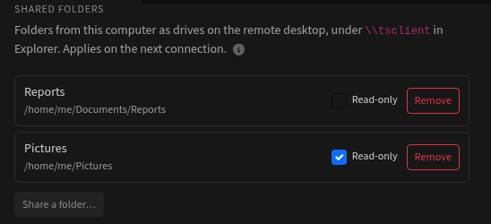

[← README](../README.md)

# Clipboard, files and desktop controls

These sharing features describe the default IronRDP client. The experimental FreeRDP preview currently supports
display, input and clipboard text, the ways the clipboard setting below allows (none in view only); pictures and files
on the clipboard, file transfer, shared drives and audio are pending. See [client capabilities](../native/README.md).

## Clipboard

While a desktop has the keyboard, what you copy here goes to it and what you copy there comes here: text, pictures and
files. That is what makes it feel like part of this computer, and it also means that the desktop sees what is on your
clipboard whenever it has the keyboard (what you copy while you work in it, and what you copied elsewhere before you
clicked back into it), passwords from a password manager included, and can put anything on your clipboard, such as a
command for you to paste into a terminal here. For a desktop you don't trust that far, **Settings › Remote Desktop ›
Settings › Clipboard sharing** narrows it:

- **Both ways**, the default.
- **Only from the remote desktop to this computer:** what you copy here stays here, and a desktop connected this way
  only ever gets an empty clipboard from this side; what you copy there still comes here, files included.
- **Off:** the clipboard is left out of the connection altogether, files included.

A desktop can have its own: **Clipboard** in its profile's settings (or its profile group's, or Tabby's defaults for
remote desktop profiles), or in the form of a desktop added behind an SSH host (the host's own desktop follows the
setting); the Clipboard menu on such a desktop says so. A desktop configured twice behind a host, as an entry and as an
RDP profile at the same address, gets the narrower clipboard of the two, and a desktop opened with a narrower clipboard
while it is open already (from another profile for it, say) narrows the open one until it is closed, its reconnects
included, and when it is shown again after its server ended it; its Clipboard menu says so meanwhile. Changes apply on
the next connection, Reconnect included. Narrowing the setting also stops anything more going from here right away to
the open desktops that follow it, takes back the files offered to them, and stops a paste to all desktops or a save of
several files that is under way before its next step. Narrowing applies in full only once they reconnect: reconnect a
desktop you don't trust that far. **Paste to all desktops** leaves out the desktops that don't take this computer's
clipboard and says which. Shared folders are a setting of their own, and screenshots and **Copy log** (Settings ›
Remote Desktop › Desktops › Open desktops) still go to your clipboard: they are your own actions.

## Files

Copy files or folders in Finder and press ⌘V on the desktop, or drop them onto it, or use **Remote Desktop › Send files…** in the pane's menu; they paste in Files or Explorer. A copied folder's links go along only when they lead somewhere inside it. Files copied on the remote offer **Save to Downloads**, which saves them there (never into a folder that was there before), marks them as downloaded, as a browser does (so macOS can ask before an app among them first opens), and takes invisible characters that could disguise a name out of it. They go the ways the [clipboard](#clipboard) does.

## Shared folders

A folder on this computer can appear as a drive on the remote desktop, as mstsc's drive redirection does: in
**Settings › Remote Desktop › Settings › Shared folders**, **Share a folder…** picks one. On the remote it is
`\\tsclient\<name>` ("<name> on <this computer>" under This PC in Explorer), named after the folder; **Read-only**
keeps the remote from changing, adding or removing anything in it. Every remote desktop you connect to sees the shared
folders, so share only what each of them may have, and remove a folder to stop sharing it. Changes apply on the next
connection.

Files are served through the RDP connection as the remote reads and writes them, which suits opening and saving
documents in place; for moving large files, copying through the clipboard is just as quick. They are read and written
in the background, so a slow disk or network folder slows the drive down, not Tabby.

The remote gets the shared folder and nothing else: a symbolic link works when it points inside the folder, and one that
leads out of it isn't shown, read or written through. Only files and folders are served (no devices or pipes). A file
with more than one name (a hard link, as pnpm's `node_modules` and some backup tools make) is read-only from the remote
(as its count of names is when it is opened), since the same file may be outside the folder too; the remote can still
read it, as any file in the folder. A desktop can have up to 1,024 files open at once, and all the desktops in a Tabby
window 2,048 together. On macOS and Windows a Tabby window may have far more open than that; on Linux it depends on the
system's limit, and where that is 4,096 or less, these are half of it or more. The remote is shown 1 GB less free space
than the disk has (on a disk under 20 GB, a twentieth of its size less), and can't take that by making a file larger
than what it writes to it: a file grows beyond what is written to it only within the free space of the disk it is on (a
disk mounted inside the folder has its own), less that much. Where files can have holes (APFS, ext4), each file can grow
so, taking no space until it is written. What the remote writes takes space as any copy does.

Windows mounts shared folders (tested); xrdp can when built with FUSE (under `~/thinclient_drives`); GNOME Remote
Desktop doesn't serve drives, so there the clipboard is the way.

## Several desktops in one tab

Split a tab (Tabby's **Split** in the tab's menu, or drag one tab onto another) and each pane can show a desktop: one
machine's desktop next to another's, or next to its own console. Right-click any of them:

- **Paste to all \<n\> desktops in this tab** pastes what's on your clipboard on every desktop in the tab, in whichever
  window is active on each: text, a picture, or files and folders copied in Finder (or Explorer, or Files). Desktops
  that don't take this computer's [clipboard](#clipboard) are left out, and a note says which. So is a desktop whose
  console is in front, or that is behind a pane maximized over it (Tabby's **Maximize the active pane**): only the
  desktops showing get the paste, and the menu counts only those.
- **Type into all \<n\> desktops in this tab** sends every key you type on one desktop to the others too, shortcuts and
  **Send keys** included, until you turn it off. An orange label on each desktop says so while it's on. The mouse stays
  per desktop, and desktops in view-only mode, with their console in front or behind a maximized pane, are left out.
- **Make panes even** evens out the split's panes, which Tabby does itself but offers nowhere else.

As you click into a desktop, its name shows in its corner for a moment, like a TV naming its input ("BUILDBOX", or "WIN-11 ·
via buildhost · 1920×1080"). It shows by default where it helps (in a split, and for a desktop other than the tab's own
connection); **Settings › Remote Desktop › Desktop name overlay** sets when, and its font, size, place and color, with a
preview. Desktops are named after their SSH profile's name.

## Microphone

Optional (off by default): an app on the remote desktop that records, such as a call, gets your microphone. It is only captured while the remote asks for it, with a red dot in the corner of the desktop and a red microphone in Tabby's header, which stays also while the desktop is hidden or its tab is in the background (in full screen, where Tabby hides its header, it shows at the top of the window, in the middle): click it to show that desktop, or to stop sending the microphone there. Stopped, a desktop gets it again only once **Send the microphone** is turned back on in its menu, or Tabby restarts, its reconnects included; the same switch keeps it from a desktop beforehand. A desktop that starts receiving it while it isn't showing also brings a note.

## Keyboard on macOS

⌘C, ⌘V, ⌘Z and the rest work as on a Mac; tapping ⌘ alone is the Windows key, and ⌃⌘ with a key is the Windows key with it (⌃⌘R for Win+R). Tabby's own shortcuts stay out of the way while a desktop is showing, except switching tabs and returning to the console.

## Send keys

In the desktop's menus: Ctrl+Alt+Del, Win+R, Win+L, Ctrl+Shift+Esc, Print Screen and more for Windows; Super, Super+A, Alt+F2 and more for GNOME.

## View only

In the desktop's menus: watch a desktop without touching it. No keys or clicks go to it while a "View only" label shows; the picture, clipboard and sound carry on. Kept across reconnects, until the desktop is closed.

## Screenshots

**Save a screenshot** in the desktop's menus saves the remote screen at its full resolution as a PNG in Downloads, and copies it to the clipboard.
